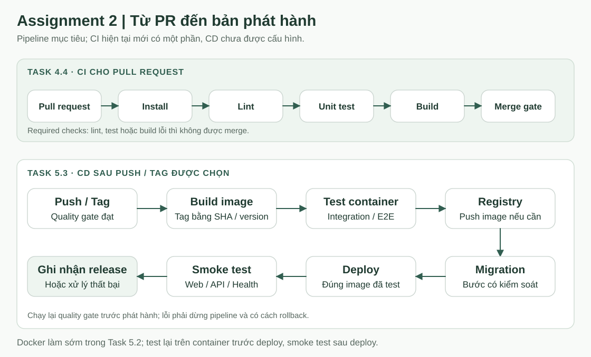

# BrewLite: kế hoạch hoàn thiện Assignment 2

Cập nhật: 21/10/2026.

Nguồn yêu cầu: [Assignment2-BrewLite.pdf](Assignment2-BrewLite.pdf), đặc biệt mục 6–9. Tài liệu tập trung Task 4–5 và ghi rõ các điều kiện đầu vào từ Task 1–3. Đây là kế hoạch cần thực hiện, không phải báo cáo các hạng mục đã hoàn thành.

Hướng dẫn chạy mã hiện tại nằm trong [README.md](README.md). Kiến trúc và luồng nghiệp vụ đang có nằm trong [PROJECT_FLOW.md](PROJECT_FLOW.md).

## 1. Nguyên tắc thực hiện và mốc nghiệm thu

Năm task được nghiệm thu theo thứ tự. Việc tái sử dụng mã nguồn Assignment 1 không thay thế tạo phẩm và lịch sử thay đổi của Task 1–3. Phần truy vết của task sau phụ thuộc tạo phẩm task trước.

| Mốc | Điều kiện để nghiệm thu |
| --- | --- |
| Task 1 | Bối cảnh/phạm vi, stakeholder, SRS có FR/NFR/MoSCoW/tiêu chí kiểm chứng, use-case tổng quát và đặc tả use-case |
| Task 2 | Activity, sequence và class diagram; có tệp nguồn và bản kết xuất, bao gồm luồng lỗi và các lớp domain tối thiểu |
| Task 3 | Mô tả kiến trúc, ADR và deployment diagram phản ánh lựa chọn triển khai thực tế |
| Task 4 / Sprint 1 | Repo và tài liệu được quản lý bằng Git; MVP menu có test; PR chạy lint/unit test/build và không merge khi check lỗi |
| Task 5 / Sprint 2 | Luồng đặt/thanh toán hoàn chỉnh, unit/integration/E2E, migration, Compose, CD, production và hồ sơ bàn giao |

Nhóm có thể chuẩn bị kỹ thuật Docker/CI sớm, nhưng không đánh dấu một task hoàn tất khi thiếu điều kiện nghiệm thu của nó.

## 2. Điểm xuất phát của repository

| Hạng mục | Đã có | Khoảng trống |
| --- | --- | --- |
| Mã ứng dụng | frontend, backend; menu, auth, giỏ, đơn, checkout và admin | Chưa dùng apps/web, apps/api; còn lỗi tích hợp/quyền |
| Tài liệu | Ba tài liệu tổng quan, khung docs và SVG minh họa | docs/requirements, diagrams, architecture mới có khung; hai file truy vết/triển khai đang rỗng |
| CI | Workflow PR vào main | Backend thiếu lint/test; frontend thiếu test; chưa xác minh required checks trên GitHub |
| Unit/API test | Test state machine, test mẫu và script payment | Chưa đủ test nghiệp vụ, API với DB test và E2E trình duyệt |
| Database | Prisma schema và seed | Chưa có migration được quản lý; .gitignore đang bỏ qua prisma/migrations |
| Docker | Compose chạy PostgreSQL | Chưa có Dockerfile web/API và Compose đủ ba dịch vụ |
| Vận hành | API ứng dụng cơ bản | Chưa có health endpoint kiểm tra DB, CD, production URL và rollback đã kiểm chứng |

Trạng thái docs được đánh giá theo nội dung, không theo việc thư mục đã được tạo. Các tệp mới phải được commit/PR trước khi dùng làm minh chứng.

## 3. Task 4: Sprint 1

### 3.1. Task 4.1 — Chuẩn hóa repo và quy trình

Chuyển ứng dụng theo cấu trúc trong đề:

~~~text
brewlite/
|-- apps/
|   |-- web/                  # Chuyển từ frontend/
|   |-- api/                  # Chuyển từ backend/
|-- docs/
|   |-- requirements/
|   |-- diagrams/
|   |-- architecture/
|   |   |-- adr/
|   |-- assets/               # Minh họa cho tài liệu tổng quan
|   |-- traceability-matrix.md
|   |-- deployment.md
|-- tests/                    # Integration/E2E cấp hệ thống
|-- .github/workflows/
|-- docker-compose.yml
|-- .env.example
|-- README.md
~~~

Có thể giữ unit test cạnh mã nguồn ứng dụng. Không bắt buộc chuyển toàn bộ unit test vào tests ở gốc, và cấu trúc này không tự yêu cầu thêm công cụ monorepo/workspace.

Công việc:

- [ ] Chuyển frontend thành apps/web, backend thành apps/api, giữ lịch sử Git.
- [ ] Cập nhật working-directory, cache-dependency-path trong CI; rà README, script, cấu hình test, đường dẫn ảnh và Docker build context.
- [ ] Giữ các hướng dẫn chạy hiện tại hoạt động trước và sau chuyển đổi; cập nhật lại tài liệu cùng PR.
- [ ] Đồng bộ .env.example với tên biến thực tế và tạo template riêng nếu cần; không đưa secret thật vào Git.
- [ ] Thống nhất main là nhánh tích hợp được bảo vệ; dùng feature/fix/docs branch và PR. develop chỉ bổ sung nếu nhóm thực sự cần.
- [ ] Tạo backlog/issue board và hai milestone Sprint 1, Sprint 2; gắn người phụ trách và tiêu chí nghiệm thu cho từng issue.
- [ ] Ghi quy ước commit, review và Definition of Done; đồng bộ TEAM_WORKFLOW.md.

**Nghiệm thu:** thành viên mới hiểu cấu trúc và chạy được dự án; công việc có issue/PR; cấu hình bảo vệ nhánh và quy trình được kiểm chứng trên GitHub.

### 3.2. Task 4.2 — Đưa tạo phẩm Task 1–3 vào docs

| Vị trí | Nội dung cần hoàn thiện |
| --- | --- |
| docs/requirements/context-and-scope.md | Stakeholder, vấn đề, in/out-of-scope, giả định, ràng buộc và rủi ro |
| docs/requirements/srs.md | FR/NFR có ID, MoSCoW, tiêu chí chấp nhận và use-case tổng quát |
| docs/requirements/use-case-checkout.md | Actor, trigger, tiền/hậu điều kiện, luồng chính/thay thế/ngoại lệ, liên kết FR |
| docs/diagrams/ | Activity, sequence, class và deployment; mỗi sơ đồ có nguồn cùng SVG/PNG/PDF kết xuất |
| docs/architecture/system-architecture.md | Kiến trúc, thành phần, ưu/hạn chế và trade-off |
| docs/architecture/adr/ | Quyết định monorepo, xác thực, giá/topping, transaction/idempotency và nền tảng deploy |
| docs/traceability-matrix.md | FR → use-case/story → sơ đồ → code/API → test |
| docs/deployment.md | Chỗ ghi nền tảng thực tế, cấu hình, release, migration, smoke test và rollback |

Tên file ngoài các vị trí bắt buộc trong đề là đề xuất tổ chức. Không tạo tài liệu rỗng rồi đánh dấu hoàn thành.

Class diagram tối thiểu cần User, Product, Order, OrderItem, Payment, Promotion và LoyaltyTransaction. Schema hiện chưa có LoyaltyTransaction; cần quyết định hiện thực/sửa thiết kế rõ ràng, không vẽ như bảng đã tồn tại.

Các SVG ở docs/assets chỉ minh họa ba tài liệu tổng quan, không thay thế bộ sơ đồ UML bắt buộc.

**Nghiệm thu:** tạo phẩm có nội dung thống nhất, được commit/PR kèm lý do thay đổi; có thể truy vết yêu cầu đến thiết kế và mã nguồn.

### 3.3. Task 4.3 — Kiểm chứng MVP menu

MVP Sprint 1 tập trung menu. Chức năng checkout sẵn có có thể tiếp tục phát triển, nhưng không thay thế việc kiểm chứng MVP này.

- [ ] GET /api/products trả danh sách và cấu trúc giá đúng.
- [ ] GET /api/products/:id trả chi tiết; ID không tồn tại được xử lý đúng.
- [ ] UI mobile-first có loading, empty và error có thể quan sát/kiểm thử.
- [ ] Có dữ liệu seed hoặc fixture tái tạo được cho test menu.
- [ ] Có test tự động cho API và component/luồng chính.
- [ ] Hướng dẫn chạy local đúng các file, cổng và biến môi trường thực tế.

**Nghiệm thu:** demo được menu từ API thật; test chứng minh dữ liệu và trạng thái UI. Test “Hello World!” không đủ minh chứng nghiệp vụ menu.

### 3.4. Task 4.4 — Hoàn thiện CI cho PR

Pipeline bắt buộc cho từng ứng dụng:

~~~text
Install → Lint → Unit Test → Build
~~~

| Job | Hiện tại | Cần bổ sung |
| --- | --- | --- |
| Backend | npm install → prisma generate → build | Lint và unit test |
| Frontend | npm install → lint → build | Test runner, test cần thiết và lệnh test |
| GitHub | Workflow PR vào main | Required status checks và quy tắc không merge khi check thất bại |

Công việc:

- [ ] Dùng cài đặt theo lockfile, ưu tiên npm ci; đồng bộ Node giữa local và CI.
- [ ] Chạy lint/test/build cho web và API; generate Prisma trước bước cần client.
- [ ] Tách unit test khỏi integration/E2E; unit test dùng mock cho phụ thuộc bên ngoài.
- [ ] Chạy test ở chế độ kết thúc một lần, không dùng watch trong CI.
- [ ] Để lỗi lint/test/build trả exit code thất bại; không bỏ qua lỗi bằng continue-on-error.
- [ ] Bật required checks trên nhánh đích để check đỏ không thể merge.
- [ ] Lưu PR/log của một lần thành công và một lần pipeline phát hiện lỗi.

Script test-payment.ts hiện ghi nhiều FAIL ra console nhưng chưa bảo đảm exit code theo tổng kết quả. Không dùng script đó như bằng chứng quality gate đã chặn lỗi.

**Nghiệm thu:** sửa lỗi có chủ đích trong PR làm pipeline đỏ và bị chặn merge; sửa lại thì pipeline xanh. Tên job trong branch rule phải khớp check thực tế.

## 4. Task 5: Sprint 2

### 4.1. Task 5.1 — Hoàn thiện luồng nghiệp vụ

| Nhóm việc | Tiêu chí cần đạt |
| --- | --- |
| Khách và đăng nhập | Giỏ gộp đúng; đổi tài khoản không lẫn dữ liệu; API gắn đơn đúng user |
| Quyền truy cập | Orders/Checkout có JWT và kiểm tra chủ đơn; admin có role/guard, không chỉ kiểm tra đăng nhập |
| Sản phẩm và giỏ | Size/topping hợp lệ; tùy chọn giống nhau mới gộp; tổng số ly theo sản phẩm được kiểm soát |
| Voucher | Một nguồn quy tắc từ backend; kiểm tra active/ngày hiệu lực/minimum/cap; thay đổi giỏ tính lại tiền |
| Tạo đơn | Tính lại từ DB, không tin giá client; từ chối giỏ rỗng, size/topping sai hoặc sản phẩm ngừng bán |
| Thanh toán | Ví/Thẻ mô phỏng, success/failure/retry có thể kiểm thử; không lặp tiền/kho/điểm |
| Trạng thái và thời hạn | Chặn chuyển sai; hết hạn và gia hạn nhất quán UI/backend; thống nhất hủy đơn đã PAID |
| Xác nhận và lịch sử | Hiển thị đúng orderId, số tiền, trạng thái và chỉ dữ liệu được cấp quyền |

Không coi toàn bộ Task 5 chỉ là “làm payment”. Phần xác thực, giỏ, validate và quyền dữ liệu phải hoàn thiện cùng luồng.

### 4.2. Task 5.2 — Kiểm thử, dữ liệu và Docker

**Phạm vi kiểm thử đề xuất**

| ID | Mức | Nội dung / kết quả mong đợi |
| --- | --- | --- |
| MENU-01 | API/UI | Menu, chi tiết, 404, loading/empty/error |
| CART-01 | Unit | Gộp đúng sản phẩm/size/topping/số phần, không phụ thuộc thứ tự topping |
| CART-02 | Unit | Tăng/xóa đúng dòng; tính tiền đúng; giỏ khách/tài khoản tách đúng |
| PROMO-01 | Unit/API | Mã sai/hết hiệu lực, min/cap, giảm cố định/phần trăm; xóa một dòng vẫn giữ mã nếu đủ điều kiện |
| AUTH-01 | API | Login đúng/sai, JWT thiếu/hết hạn, người A không đọc/sửa đơn người B; khách và tài khoản thường không dùng API admin |
| ORDER-01 | Integration | Tạo đơn nhiều biến thể cùng productId; dùng giá DB; tổng lượng không vượt kho |
| PAY-01 | Integration | Thanh toán thành công, thất bại, thử lại, đơn 0đ và đơn quá hạn |
| PAY-02 | Integration | Gửi tuần tự/đồng thời cùng key chỉ có một tác động; key cho đơn khác bị xử lý đúng |
| STOCK-01 | Integration | Nhiều người mua lượng tồn cuối cùng: không có stock âm hoặc bán vượt kho |
| LOYALTY-01 | Unit/API | Chỉ cộng điểm sau PAID, một lần; chuyển trạng thái sai bị chặn |
| E2E-01 | Trình duyệt | Menu → chọn size/topping → giỏ → login → thanh toán → xác nhận và thấy đơn trong lịch sử |

Các ID trên là đề xuất để đưa vào ma trận truy vết, chưa phải các test đã được tạo/chạy. Task 5 yêu cầu ít nhất một E2E từ menu đến xác nhận; test HTTP endpoint gốc không thay thế E2E đó.

**Database và môi trường test**

- [ ] Dùng database test riêng, fixture riêng và cơ chế dọn dữ liệu; không trỏ integration test vào dữ liệu dùng thật.
- [ ] Bỏ quy tắc ignore prisma/migrations; tạo và commit migration có thể tái tạo database mới.
- [ ] Nếu DB local đã có dữ liệu, thống nhất baseline trước; không reset DB để tạo lịch sử migration.
- [ ] Dùng migrate dev khi phát triển, migrate deploy khi CI/deploy chạy migration đã được duyệt.
- [ ] Tách seed/fixture test khỏi dữ liệu production; seed hiện xóa dữ liệu, không gắn vào startup.
- [ ] Bổ sung GET /api/health và xác định hành vi khi DB không sẵn sàng.

**Đóng gói và kiểm tra trên container**

- [ ] Tạo Dockerfile và .dockerignore cho apps/web, apps/api; build có thể lặp lại từ lockfile.
- [ ] Tạo docker-compose.yml ở gốc với web, api, db; DB có persistent volume và healthcheck.
- [ ] API dùng db:5432 trong mạng container; browser dùng URL API mà người dùng truy cập được.
- [ ] Phân biệt biến frontend tại thời điểm build với biến backend tại runtime.
- [ ] Chạy migration bằng job/bước riêng có kiểm soát; không để mọi replica tự chạy seed/migration khi khởi động.
- [ ] Test integration/E2E lại trên hệ thống đã đóng gói; kiểm tra khởi động mới, dữ liệu tồn tại sau restart và health check.

Dockerfile dùng để build image, Compose tổ chức các dịch vụ. Nên làm Docker ngay khi MVP đủ chạy, không chờ “test xong toàn bộ” mới đóng gói. Bộ kiểm tra cần chạy lại trong môi trường container trước phát hành.

**Nghiệm thu:** clone mới, cấu hình môi trường, chạy Compose và test được; có log chứng minh unit/API/E2E, idempotency và chống vượt kho.

### 4.3. Task 5.3 — Thiết lập CD

CI kiểm tra thay đổi trước merge. CD đóng gói/phát hành phiên bản đã đạt quality gate lên môi trường triển khai.

~~~text
Push vào nhánh phát hành / Tag
  → Install, Lint, Test và Build
  → Build Docker image
  → Kiểm tra integration/E2E trên bản đóng gói
  → Push image lên registry nếu nền tảng cần
  → Migration và Deploy có kiểm soát
  → Health check / Smoke test
  → Ghi nhận phiên bản hoặc xử lý thất bại
~~~

Phần integration/E2E trong chuỗi trên là bố trí đề xuất để kiểm chứng bản đóng gói; yêu cầu chính của đề gồm quality gate, image/tag, deploy, migration, smoke test và rollback.

Công việc:

- [ ] Chọn nền tảng triển khai và registry theo quyết định của nhóm, ghi ADR và deployment diagram trước khi nghiệm thu. Chưa mặc định dùng Render, Vercel hay nhà cung cấp khác.
- [ ] Tạo .github/workflows/cd.yml; trigger và quyền deploy được ghi rõ.
- [ ] Tag image bằng commit SHA hoặc semantic version; lưu phiên bản đã triển khai.
- [ ] Deploy đúng image đã kiểm tra, không build lại bản khác ở production.
- [ ] Lưu credential/connection string/JWT secret trong hệ thống secret của CI hoặc nền tảng; không ghi vào log.
- [ ] Backup dữ liệu và đánh giá migration tương thích trước khi thực thi.
- [ ] Chạy smoke test web/API/health sau deploy; lỗi phải làm pipeline thất bại.
- [ ] Ghi rõ rollback về image/release trước; rollback DB có kế hoạch riêng, không giả định đổi image sẽ hoàn tác schema.

Có thể chọn Continuous Delivery với bước duyệt phát hành hoặc Continuous Deployment tự động sau gate. Phải mô tả đúng cách nhóm triển khai và có minh chứng chạy thực tế.

**Nghiệm thu:** một push/tag đi qua pipeline đến bản chạy thật; có log thành công, cách nhận biết lỗi và cách khôi phục được kiểm chứng.

### 4.4. Task 5.4 — Production và bàn giao

- [ ] Frontend có URL HTTPS truy cập được.
- [ ] API và health check có URL vận hành rõ ràng; database không mở public trực tiếp.
- [ ] Secret được cấu hình đúng; JWT fallback, log OTP và dữ liệu test không đi vào production.
- [ ] Có release/tag, release notes và phiên bản image tương ứng.
- [ ] docs/deployment.md ghi môi trường, biến cấu hình, migrate, deploy, smoke test, backup và rollback.
- [ ] README hướng dẫn chạy local, test, build, deploy và rollback; chỉ ghi URL đã hoạt động.
- [ ] Có video/demo từ menu đến xác nhận đơn, Sprint Review và Sprint Retrospective.
- [ ] Ma trận truy vết có đường dẫn đến mã nguồn, test và bằng chứng chạy.
- [ ] Một người ngoài nhóm có thể clone, chạy theo hướng dẫn và kiểm tra URL production.

**Nghiệm thu:** sản phẩm có thể truy cập qua HTTPS và hồ sơ phản ánh đúng bản phát hành. Chỉ chạy Compose trên máy cá nhân chưa đáp ứng yêu cầu production của đề.

## 5. Thứ tự công việc nên thực hiện tiếp

1. Hoàn thiện tạo phẩm Task 1–3 và quyết định nghiệp vụ còn thiếu; review và commit chúng.
2. Chuẩn hóa apps/web, apps/api và cập nhật mọi đường dẫn liên quan trong cùng PR.
3. Bổ sung test menu, unit test cần thiết và hoàn thiện CI/required checks để nghiệm thu Task 4.
4. Sửa tích hợp auth/quyền/checkout; viết unit/API test song song với chức năng.
5. Tạo migration, fixture test, health endpoint, Dockerfile và Compose; chạy integration/E2E trên container.
6. Chọn môi trường production, hoàn thiện deployment diagram/ADR và triển khai CD.
7. Release, deploy, smoke test, xác minh rollback và hoàn tất tài liệu/minh chứng bàn giao.

Đây là thứ tự phụ thuộc và nghiệm thu, không cấm các thành viên chuẩn bị song song các phần độc lập. Mỗi issue cần người phụ trách và bằng chứng hoàn thành; không ấn định lịch Sprint khi nhóm chưa thống nhất ngày.

## 6. Definition of Done chung

Một hạng mục chỉ được đóng khi đáp ứng tiêu chí chấp nhận, được review và có bằng chứng phù hợp: mã chạy được, lint/test/build cần thiết đạt, tài liệu được cập nhật và CI không bỏ qua lỗi. Với thay đổi triển khai, phải kiểm tra trên môi trường đích và có kế hoạch khôi phục.

Các lệnh/đường dẫn apps/web, apps/api trong kế hoạch chỉ áp dụng sau khi chuyển thư mục. Trong lúc repository còn cấu trúc cũ, tiếp tục chạy theo README, không sửa đường dẫn CI trước khi chuyển mã tương ứng.
