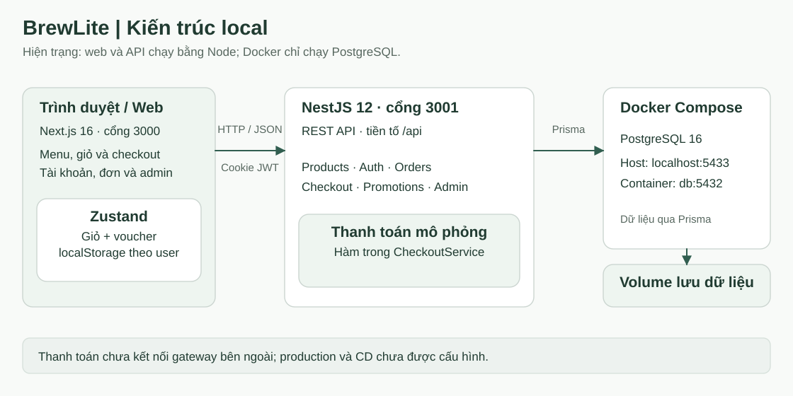
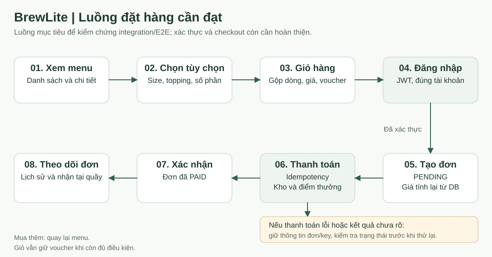
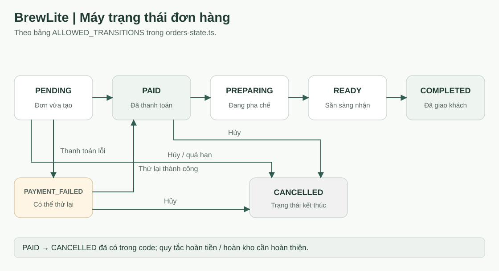

# BrewLite: kiến trúc và luồng hệ thống

Cập nhật: 21/10/2026.

Tài liệu mô tả mã nguồn đang có và các quy tắc nghiệp vụ cần đạt. Các phần chưa hoàn thiện được ghi rõ để tránh nhầm giữa thiết kế mong muốn và hành vi hiện tại. Hướng dẫn chạy nằm trong [README.md](README.md); kế hoạch thực hiện nằm trong [ASSIGNMENT2_PLAN.md](ASSIGNMENT2_PLAN.md).

## 1. Phạm vi sản phẩm

Luồng cốt lõi: xem menu, chọn size/topping, quản lý giỏ, đăng nhập, tạo đơn, thanh toán mô phỏng, theo dõi đơn và nhận đồ uống tại quầy.

| Vai trò | Công việc |
| --- | --- |
| Khách chưa đăng nhập | Xem menu, chọn món, lưu giỏ trên trình duyệt |
| Khách có tài khoản | Đăng nhập, thanh toán, xem hồ sơ và lịch sử đơn |
| Nhân viên/quản lý | Theo dõi đơn, chuyển trạng thái, quản lý tồn kho và khuyến mãi |
| Nhóm phát triển | Hoàn thiện nghiệp vụ, kiểm thử, quản lý tài liệu và triển khai |

Mã nguồn đã có màn hình admin và kho; đây không còn là phần hoàn toàn ngoài phạm vi như tài liệu cũ. Tuy nhiên, quyền nhân viên/admin chưa được phân tách đầy đủ. Cổng thanh toán thật, vận chuyển và quản trị nguyên liệu chi tiết chưa thuộc MVP đã thống nhất ở đây.

Giao diện mobile-first đang được phát triển bằng Next.js. Không coi PWA là hoàn tất khi chưa có cấu hình và kiểm chứng riêng.

## 2. Kiến trúc đang chạy ở local

| Thành phần | Trách nhiệm | Vị trí hiện tại |
| --- | --- | --- |
| Next.js 16, cổng 3000 | Trang sản phẩm, giỏ, tài khoản, checkout, đơn và admin | frontend/src |
| Zustand | Giữ giỏ đang hoạt động và voucher | frontend/src/stores/cart.store.ts |
| localStorage | Lưu giỏ riêng cho khách hoặc từng tài khoản; lưu timer checkout | Trình duyệt |
| Axios/TanStack Query | Gọi API, gửi cookie và quản lý dữ liệu từ server | frontend/src/lib và hooks |
| NestJS 12, cổng 3001 | REST API, DTO validation, xác thực, nghiệp vụ và cron | backend/src |
| Prisma/PostgreSQL 16 | Đọc/ghi dữ liệu, transaction và kiểm soát stock/version | backend/prisma |
| Cổng thanh toán mô phỏng | Trả kết quả thanh toán trong CheckoutService | Cùng process backend |

Trên máy host, PostgreSQL dùng localhost:5433; trong container database vẫn nghe cổng 5432. Khi bổ sung API vào Compose, API sẽ kết nối tên service db:5432 thay vì localhost:5433.

Backend chưa gọi một cổng thanh toán bên ngoài bằng HTTP. Hàm callMockGateway hiện mô phỏng độ trễ và mặc định thành công; nhánh thất bại phải có cách kiểm thử chủ động.

### 2.1. Các module backend

| Module | Trách nhiệm |
| --- | --- |
| Products | Menu, chi tiết sản phẩm và topping |
| Auth | Đăng ký, OTP email, đăng nhập, hồ sơ và địa chỉ |
| Orders | Tạo đơn, tính lại tiền từ DB, lịch sử và chi tiết |
| Checkout | Voucher cho đơn, xử lý thanh toán, thời hạn và dọn đơn quá hạn |
| Promotions | Danh sách và kiểm tra mã ưu đãi |
| Admin | Danh sách đơn, chuyển trạng thái, cập nhật kho và tạo mã |
| Email | Gửi OTP qua SMTP |
| Prisma | Cung cấp Prisma client cho các module |

## 3. Mô hình dữ liệu hiện tại

Nguồn chính xác là [schema.prisma](backend/prisma/schema.prisma).

| Model | Dữ liệu và quan hệ chính |
| --- | --- |
| User | Email duy nhất, passwordHash, loyaltyPoints; có nhiều Order và Address |
| EmailVerification | Một bản ghi xác minh cho mỗi user; codeHash, hạn OTP và số lần thử |
| Address | Thuộc User; thông tin liên hệ và địa chỉ mặc định |
| Product | Tên, danh mục, allowToppings, stock, version, isAvailable |
| ProductPrice | Thuộc Product; duy nhất theo cặp productId/size |
| Topping | Tên duy nhất, giá và trạng thái bán |
| Order | Thuộc User; tổng sau giảm, discount, promoCode, status và điểm đã nhận |
| OrderItem | Thuộc Order và Product; size, qty, lineTotal, snapshot tên topping |
| Payment | Thuộc Order; idempotencyKey duy nhất, số tiền, phương thức và kết quả |
| Promotion | Mã duy nhất; kiểu giảm, điều kiện, trần giảm, thời gian và isActive |

Một topping có thể xuất hiện nhiều lần trong OrderItem.toppings để biểu diễn nhiều phần. Hiện không có bảng liên kết OrderItem–Topping; tên được lưu dạng snapshot.

Order.promoCode là chuỗi, chưa có foreign key sang Promotion. Điểm nằm trực tiếp trên User và Order; schema chưa có LoyaltyTransaction như mô hình domain tối thiểu mà Assignment 2 yêu cầu. Nhóm phải giải quyết và ghi quyết định trước khi nghiệm thu thiết kế/dữ liệu.

## 4. Luồng khách hàng và giỏ hàng

Sơ đồ thể hiện luồng cần đạt; các điểm thiếu trong xác thực/checkout được liệt kê ở mục 8.

### 4.1. Xem menu và chọn tùy chọn

1. Frontend lấy menu và bảng giá từ Products API.
2. Khách mở chi tiết, chọn một size thực sự được bán.
3. Nếu sản phẩm cho phép topping, khách chọn loại và số phần topping.
4. Frontend tính số tiền dự kiến, rồi thêm món vào giỏ.

Giá size được lưu trực tiếp trong ProductPrice, không tính bằng hệ số S/M/L chung cho mọi sản phẩm.

### 4.2. Định danh một dòng giỏ

Một dòng được nhận diện bằng sản phẩm, size và số phần của từng loại topping. Thứ tự chọn topping không làm thay đổi định danh.

| Lựa chọn | Kết quả |
| --- | --- |
| Cùng sản phẩm, size M, trân châu x1; thêm lại cấu hình đó | Một dòng, cộng số ly |
| Cùng sản phẩm, size M, trân châu x1 và thạch x1 | Hai dòng |
| Cùng sản phẩm, size M, trân châu x1 và trân châu x2 | Hai dòng |
| Cùng topping nhưng size M và L | Hai dòng |
| Hai sản phẩm khác ID nhưng trùng tên | Hai dòng |

Các hàm chung nằm trong [frontend/src/lib/cart.ts](frontend/src/lib/cart.ts). Tiền một dòng bằng đơn giá đã gồm topping nhân số ly. Khi gửi tạo đơn, quantity được đổi thành qty; topping được chuyển thành mảng tên theo contract API.

### 4.3. Lưu giỏ và chuyển tài khoản

Giỏ khách dùng key brewlite_cart_guest; giỏ tài khoản dùng key có tiền tố brewlite_cart_user_ và userId. Khi nhận diện đăng nhập, frontend gộp giỏ khách theo cùng quy tắc tùy chọn rồi xóa giỏ khách đã gộp.

Khi đăng xuất hoặc đổi tài khoản, giỏ đang hiển thị phải chuyển đúng chủ sở hữu. Cần integration/E2E kiểm chứng luồng này cùng xác thực ở backend; việc có giỏ riêng trong localStorage không bảo đảm đơn được gắn đúng user.

### 4.4. Voucher khi giỏ thay đổi

Frontend giữ quy tắc của voucher để tính lại theo tổng mới:

- Giữ mã nếu giỏ còn đạt giá trị tối thiểu.
- Tính lại giảm theo phần trăm hoặc số tiền cố định, áp trần và không giảm vượt tổng giỏ.
- Bỏ mã khi giỏ trống hoặc không còn đủ điều kiện.
- Ví dụ: giỏ 150.000đ dùng giảm 10%, trần 15.000đ; xóa một dòng còn 90.000đ thì giữ mã và giảm 9.000đ.

Đây là số tiền dự kiến trên UI. Khi tạo/thanh toán đơn, backend phải xác minh lại giá và điều kiện voucher. Hiện logic nhập mã ở checkout vẫn hardcode một số mã, chưa hoàn toàn thống nhất với Promotions API.

## 5. Xác thực và quyền truy cập

Login ký JWT và đặt cookie access_token với HttpOnly, SameSite=Lax, thời hạn 7 ngày; Secure được bật trong production. JwtStrategy đọc cookie, hoặc Bearer token dự phòng, rồi tìm user trong database.

Axios gửi cookie bằng withCredentials. Các API được gắn JwtAuthGuard mới thực thi bước xác minh đó; chỉ gửi cookie không tự tạo req.user.

| Nhóm API | Hiện trạng trong code | Quy tắc cần đạt |
| --- | --- | --- |
| Menu, topping, khuyến mãi | Public | Cho phép xem trước khi đăng nhập |
| Hồ sơ và địa chỉ | Có JwtAuthGuard | Chỉ thao tác dữ liệu của chính user |
| Đơn hàng | Chưa gắn guard; có fallback guest sang user đầu tiên | Bắt buộc xác thực và kiểm tra chủ đơn |
| Checkout/payments | Chưa gắn guard và kiểm tra userId cho từng orderId | Chỉ chủ đơn hoặc vai trò được cấp quyền mới được truy cập |
| Admin | Có JwtAuthGuard, chưa có kiểm tra role | Chỉ nhân viên/quản lý được cấp quyền |

Frontend chặn điều hướng không thay thế việc kiểm tra quyền tại API. Schema User chưa có role; bổ sung phân quyền cần thay đổi schema, migration, guard và UI tương ứng.

## 6. API đang có

Base URL local: http://localhost:3001/api. Mọi đường dẫn dưới đây nằm sau /api.

| Nhóm | Method và đường dẫn | Nội dung |
| --- | --- | --- |
| Products | GET /products, GET /products/:id | Menu và chi tiết, có prices |
| Products | GET /products/toppings | Topping đang bán |
| Auth | POST /auth/register, /auth/verify-email, /auth/resend-verification | Đăng ký và OTP |
| Auth | POST /auth/login, /auth/logout | Đăng nhập/đăng xuất |
| Auth | GET /auth/me; PATCH /auth/profile | Hồ sơ |
| Auth | POST /auth/addresses; PATCH /auth/addresses/:id/default; DELETE /auth/addresses/:id | Quản lý địa chỉ |
| Orders | POST /orders; GET /orders/me; GET /orders/:id | Tạo và tra cứu đơn |
| Promotions | GET /promotions; POST /promotions/apply | Xem và kiểm tra voucher theo subtotal |
| Checkout | POST /checkout | Thanh toán mô phỏng |
| Checkout | POST /checkout/apply-voucher | Áp voucher cho đơn có sẵn |
| Checkout | GET /checkout/order/:orderId, GET /checkout/status/:orderId | Lịch sử thanh toán và thời gian còn lại |
| Admin | GET /admin/orders, /admin/orders/counts | Quản lý đơn và thống kê |
| Admin | PATCH /admin/orders/:id/status | Chuyển trạng thái |
| Admin | GET /admin/products; PATCH /admin/products/:id/stock, /admin/products/:id/availability | Quản lý kho |
| Admin | POST /admin/promotions | Tạo mã khuyến mãi |

CheckoutController cũng nhận tiền tố /payments, vì vậy /payments và các route con tương ứng đang là alias. Frontend hiện gọi /checkout; module PaymentsService cũ chưa chứa logic thanh toán chính.

Health endpoint phục vụ readiness/database chưa có. Không coi GET /api trả “Hello World!” là kiểm tra sức khỏe đầy đủ.

### 6.1. Payload tạo đơn

~~~json
{
  "items": [
    {
      "productId": "uuid-san-pham",
      "size": "M",
      "qty": 2,
      "toppings": ["Trân châu", "Trân châu"],
      "lineTotal": 100000
    }
  ],
  "promoCode": "WELCOME10"
}
~~~

DTO hiện vẫn yêu cầu lineTotal; backend tính lại giá từ ProductPrice và Topping thay vì tin số tiền client gửi. Ví dụ trên là hình dạng dữ liệu, không phải fixture có UUID hay giá sẵn trong DB.

### 6.2. Payload thanh toán

~~~http
POST /api/checkout
Content-Type: application/json
Idempotency-Key: <uuid-cua-lan-thanh-toan>
~~~

~~~json
{
  "orderId": "uuid-don-hang",
  "method": "EWALLET"
}
~~~

method nhận EWALLET hoặc CARD. Cùng một thao tác được gửi lại sau timeout phải giữ key để chống xử lý lặp. Response thanh toán hiện có payment, isDuplicate và thông tin kết quả; không có cùng wrapper data như Products/Orders. Frontend kiểm tra lại đơn bằng GET /orders/:id trước khi xác nhận thành công.

## 7. Tạo đơn, thanh toán và trạng thái

### 7.1. Tạo đơn

OrdersService nhận các dòng giỏ, lấy danh sách productId duy nhất, kiểm tra sản phẩm/size và tổng số ly của mỗi sản phẩm so với kho. Service tính lại giá từng dòng, áp mã nếu có và tạo Order PENDING cùng OrderItem trong transaction.

Kho chưa được giữ/trừ khi tạo PENDING. Kiểm tra kho lúc tạo đơn không bảo đảm kho vẫn đủ khi khách bấm thanh toán sau đó.

### 7.2. Thanh toán

CheckoutService hiện thực các bước chính:

1. Kiểm tra voucher nếu request có mã.
2. Tra payment theo Idempotency-Key để xử lý yêu cầu gửi lại tuần tự.
3. Lấy đơn, chặn đơn rỗng, trạng thái không phù hợp và đơn quá hạn.
4. Mở transaction, khóa dòng Order bằng SELECT FOR UPDATE và kiểm tra lại trạng thái/tổng tiền.
5. Gọi hàm thanh toán mô phỏng; đơn 0đ có nhánh hoàn tất riêng.
6. Nếu thành công, trừ tổng số ly của mỗi sản phẩm bằng điều kiện stock/version, tạo Payment, đổi Order sang PAID và cộng điểm.
7. Nếu thất bại, lưu trạng thái thanh toán thất bại và PAYMENT_FAILED.

Một sản phẩm có nhiều dòng tùy chọn chỉ được cập nhật stock/version một lần trong cùng lượt thanh toán. Điểm được tính bằng phần nguyên của tổng tiền đã giảm chia 10.000.

Idempotency tuần tự đã có đường xử lý, nhưng cần bổ sung kiểm tra cùng key cho khác đơn và trường hợp hai request đồng thời. Mô phỏng chưa chứng minh việc thu tiền thực; nếu tích hợp gateway thật, cần thiết kế lại tính nhất quán giữa gateway và transaction DB.

### 7.3. Máy trạng thái đơn hàng

Nguồn quy tắc là [orders-state.ts](backend/src/modules/orders/orders-state.ts).

| Trạng thái | Được chuyển sang |
| --- | --- |
| PENDING | PAID, PAYMENT_FAILED, CANCELLED |
| PAYMENT_FAILED | PAID, CANCELLED |
| PAID | PREPARING, CANCELLED |
| PREPARING | READY |
| READY | COMPLETED |
| COMPLETED, CANCELLED | Không có trạng thái tiếp theo |

Admin dùng assertTransition để chặn chuyển sai. Checkout xử lý trạng thái bằng các kiểm tra riêng; cần test để hai đường không mâu thuẫn.

Code cho phép PAID → CANCELLED nhưng chưa có quy trình hoàn tiền/hoàn kho tương ứng đầy đủ. Nhóm cần thống nhất quy tắc này trước nghiệm thu, không coi việc đổi trạng thái là đã hoàn tiền.

### 7.4. Hết hạn và gia hạn

Hạn thanh toán backend hiện là 2 phút tính từ createdAt. Cron quét đơn PENDING quá hạn mỗi 30 giây. UI có timer và một lần gia hạn bằng localStorage, nhưng gia hạn UI chưa cập nhật tuổi đơn/backend; đây là phần cần sửa và kiểm thử.

## 8. Những khoảng trống cần giải quyết

| Vấn đề | Tác động / công việc tiếp theo |
| --- | --- |
| Guest fallback và thiếu guard ở Orders/Checkout | Có thể gắn đơn sai user hoặc truy cập đơn không thuộc tài khoản |
| Chưa có role admin | Tài khoản thông thường có thể gọi API quản trị sau khi đăng nhập |
| Idempotency chưa đầy đủ ở nhánh đồng thời | Cần trả kết quả nhất quán và không lặp tiền/kho/điểm |
| Voucher có nhiều đường xử lý | Thống nhất quy tắc theo backend, gồm trạng thái và khoảng ngày hiệu lực |
| Topping không hợp lệ bị bỏ qua khi tính giá | Phải từ chối topping ngừng bán/không cho phép, không lưu món không tính đúng tiền |
| Gia hạn UI và backend lệch nhau | Đồng bộ thời hạn hoặc thiết kế tạo đơn thay thế an toàn |
| Seed xóa dữ liệu, user seed không đăng nhập được | Tách fixture test khỏi dữ liệu vận hành; không chạy seed mỗi lần deploy |
| Log OTP và JWT fallback phục vụ dev | Loại bỏ hành vi không phù hợp trước production |
| Thiếu migration/health/Compose đủ dịch vụ | Hoàn thiện nền tảng kiểm thử và vận hành |
| Bộ test và CI chưa đủ | Thực hiện kế hoạch Task 4.4 và 5.2 |

## 9. Liên kết với Assignment 2

Task 4 kiểm chứng MVP menu, quản lý tài liệu và CI cho PR. Task 5 hoàn thiện luồng đặt/thanh toán, test nghiệp vụ/API/trình duyệt, Docker, CD và bàn giao production.

Tài liệu này là bản mô tả tổng quan phục vụ nhóm, chưa thay thế SRS, activity/sequence/class diagram, ADR, deployment diagram hay ma trận truy vết trong docs. Các SVG tại docs/assets là minh họa tổng quan; bộ sơ đồ nghiệm thu phải có tệp nguồn và bản kết xuất, thống nhất với yêu cầu và schema.
